# InpremClockingApp — Multi-Tenancy Design v0.5

> Text version of `design-v0.5.docx` for Claude Code. Wherever this document mentions approvals, sign-offs, the CTO, the project owner or open questions, those have been settled in `build/DECISIONS.md`; follow that file. Phase entry and exit checks in the build pack replace the approval gates described here.

Version 0.5: hostnames and two-site deployment, website registration and subscriptions, change control, recovery, database safety and acceptance criteria

**Status:** Draft for CTO and project owner approval (version 0.5). Replaces version 0.4. Design only: no application code has been changed. Companion: Claude Code phase prompts (Markdown).

**Date:** 12 October 2026

**Baseline:** Branch fix/login-admin-only, commit 1061ea8. The clocking app on this branch is approved and its behaviour is preserved.

**Scope:** Multi-tenancy layer: tenancy, Provider Console, PayPal billing, Twilio alerts and the website API for registration and subscriptions.

**Hostnames:** inpremclockin.org (marketing website), app.inpremclockin.org (back office, kiosk, website API), admin.inpremclockin.org (Provider Console).

**Approval needed:** Section 15 lists the questions for the CTO and the project owner. Coding starts only after written approval.

# 1. Summary

Version 0.3 answered the CTO's review: layered architecture for new code, no forms on top of tables, no hardcoded provider credentials and an API for the website team. Version 0.4 answered five review requests. Version 0.5 adds the CTO's hostname decision and the deployment model, and is accompanied by step-by-step prompts for Claude Code. Earlier decisions stand unless a conflict forced a change.

## 1.0 Changes in version 0.5

| **Topic**                                  | **Decision**                                                                                                                                                                                       | **Section**     |
|--------------------------------------------|----------------------------------------------------------------------------------------------------------------------------------------------------------------------------------------------------|-----------------|
| Hostnames (CTO decision)                   | inpremclockin.org marketing website; app.inpremclockin.org organization back office, kiosk and website API; admin.inpremclockin.org Provider Console                                               | 2.1             |
| Deployment (CTO: either option acceptable) | One codebase deployed as two sites from the same build: App site and Admin site. Local development runs both in one process                                                                        | 2.2             |
| Website API location                       | https://app.inpremclockin.org/api/public/v1; token-only authentication, never the back-office cookie; CORS for the marketing domain only. An api. hostname can be added later without code changes | 2.3, 7          |
| Provider Console path                      | Served at the root of admin.inpremclockin.org (previously /provider)                                                                                                                               | 2.1, 6          |
| Login cookies                              | Each hostname has its own host-only cookie, so provider and organization sessions cannot mix                                                                                                       | 2.4             |
| Background jobs and migrations             | Run only from the App site; the Admin site shows the jobs dashboard without running jobs; migrations run from the pipeline, never at startup                                                       | 2.2             |
| Domain transition                          | The approved app moves from inpremclockin.org to app.inpremclockin.org; old paths redirect permanently once the marketing site takes over the root domain                                          | 2.5, C3-11      |
| Implementation prompts                     | One Markdown prompt per phase, plus shared guardrails, for Claude Code                                                                                                                             | Companion files |

## 1.1 Review requests and where they are answered

| **\#** | **Request**                                                         | **Answer in this version**                                                                                                                | **Section** |
|--------|---------------------------------------------------------------------|-------------------------------------------------------------------------------------------------------------------------------------------|-------------|
| 1      | Website supports public registration and subscription activities    | Four customer journeys, full endpoint list, PayPal checkout started from the website, and a three-source subscription-status confirmation | 7           |
| 2      | Which existing files may change while preserving approved behaviour | File-by-file change-control register in four categories, with rules and a behaviour baseline captured before any change                   | 10          |
| 3      | Stronger first Provider Owner recovery                              | Bootstrap code from the secret store, two-owner minimum, four recovery levels, two-person break-glass, notifications, drills              | 5           |
| 4      | Database inspection, migration, backup and rollback plan            | Six-step procedure with inspection queries, tested backups, rehearsal, expand-then-contract migrations and three rollback levels          | 11          |
| 5      | Measurable acceptance criteria per phase                            | Numbered criteria per phase, including automated tenant-isolation and security test suites that run on every pull request                 | 12, 13      |

## 1.2 Decisions changed in version 0.4 (still valid)

| **Topic**                           | **Version 0.3**                                                        | **Version 0.4**                                                                                                           | **Reason**                                                                                        |
|-------------------------------------|------------------------------------------------------------------------|---------------------------------------------------------------------------------------------------------------------------|---------------------------------------------------------------------------------------------------|
| Where subscriptions start           | Only inside the app (Billing page); the website never touched payments | The website can start and manage subscriptions through the API; the in-app Billing page remains and uses the same backend | New requirement (review item 1)                                                                   |
| Who creates the PayPal subscription | Browser button on the in-app page                                      | Our server creates it and returns PayPal's approval link; the website only redirects                                      | The website team then needs no PayPal credentials and cannot tamper with plan or price            |
| PayPal custom_id                    | Tenant id                                                              | Checkout-session reference                                                                                                | A checkout can start before the organization is fully activated, and internal ids are not exposed |
| Existing migrations                 | Version 0.2 proposed squashing them into a fresh baseline              | Existing migration history is kept unchanged; only new, additive migrations are added                                     | Preserves the approved app and its database; lower risk (review item 4)                           |
| Bootstrap                           | Server command only                                                    | Server command plus a one-time bootstrap code from the secret store; second owner required before go-live                 | Stronger recovery (review item 3)                                                                 |

Everything else from version 0.3 stands: shared database with TenantId, one account per person with memberships, Provider Console (now on admin.inpremclockin.org) with list → detail → separate create and edit pages, PayPal Subscriptions plus Invoicing, Twilio Messaging and Verify, Hangfire jobs, and the layered project structure.

# 2. Scope

**Diagram: Hostnames, the two sites built from one codebase, and external services.**

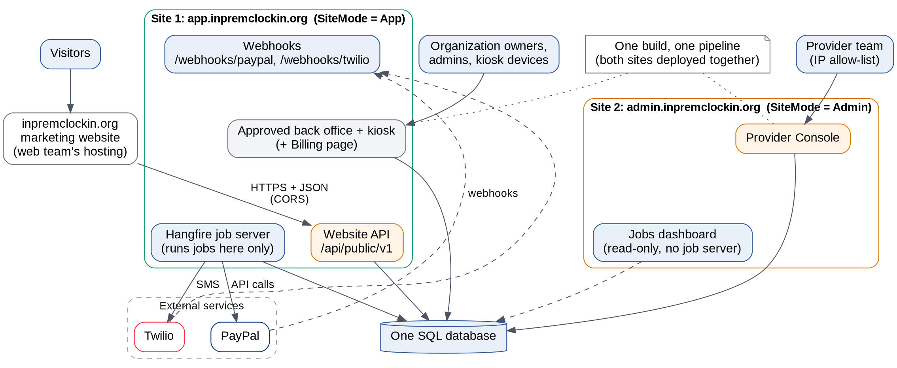

| **Part**                                                                                                                        | **Status**                                                              |
|---------------------------------------------------------------------------------------------------------------------------------|-------------------------------------------------------------------------|
| Kiosk, back office, reports, PDFs, exports (approved app)                                                                       | Behaviour preserved. Only the changes listed in Section 10 are allowed. |
| Rejected multi-tenancy code (/Platform pages, TenantAdminService, BillingService, BillingBackgroundService, InvoicesController) | Replaced by the new design                                              |
| Provider Console, website API, PayPal, Twilio, memberships, audit, recovery                                                     | New, in separate projects and areas                                     |

## 2.1 Hostnames

| **Hostname**                 | **Serves**                                                                                                                                                                               | **Users**                                                                  | **Hosted by**   |
|------------------------------|------------------------------------------------------------------------------------------------------------------------------------------------------------------------------------------|----------------------------------------------------------------------------|-----------------|
| inpremclockin.org (and www.) | Marketing website: home, pricing, signup, subscribe, manage subscription                                                                                                                 | Public                                                                     | Web team        |
| app.inpremclockin.org        | Approved back office and kiosk (same paths as today), Billing page, “Choose organization” page, website API /api/public/v1, webhooks /webhooks/\*, email verification and password pages | Organization owners, admins, kiosk devices; the website; PayPal and Twilio | Us (App site)   |
| admin.inpremclockin.org      | Provider Console at the root (/, /tenants, /plans, /billing, ...), provider login, jobs dashboard                                                                                        | Provider team only                                                         | Us (Admin site) |

There are no per-organization subdomains. The organization is still taken from the signed-in membership (Section 4), so approved page paths do not change; only the hostname does.

## 2.2 Deployment: one codebase, two sites

| **Rule**              | **Detail**                                                                                                                                                                     |
|-----------------------|--------------------------------------------------------------------------------------------------------------------------------------------------------------------------------|
| Same build            | One CI build produces one package. The pipeline deploys it to both sites in the same release, so they can never run different versions against the same database               |
| Site mode             | A setting SiteMode = App, Admin or All (local development only). Each area is mapped only for its mode and host (RequireHost); requests for the other site's routes return 404 |
| Background jobs       | Hangfire job server runs only on the App site (Jobs:RunServer = true). The Admin site shows the Hangfire dashboard read-only and does not process jobs                         |
| Migrations            | Applied by the pipeline as a reviewed script (Section 11), never automatically at application startup on either site                                                           |
| Admin site protection | IP allow-list or VPN in front of admin.; separate application pool or app instance; independent restarts                                                                       |
| Hosting               | Both sites can share one hosting plan (for example two apps on one Azure App Service plan); confirm pricing with the chosen host                                               |
| Data-protection keys  | Each site keeps its own key ring in persistent storage (database or key store), so cookies survive restarts; sites never need to read each other's cookies                     |
| Configuration         | Hostnames, CORS origins, email link bases and allow-lists come from configuration per environment, never hard-coded                                                            |

## 2.3 Website API location

The website API is served from the App site at https://app.inpremclockin.org/api/public/v1. Three alternatives were considered: a separate api. hostname (cleanest, but not chosen now; it can be added later as an extra hostname on the App site without code changes), a reverse proxy under inpremclockin.org/api (adds a dependency on the web team's hosting and IP-forwarding trust), and server-to-server calls from the website's own server (supported in addition, using the optional API key). Rules that keep the API separate from the back office:

- The API accepts only its own bearer tokens; it ignores the back-office authentication cookie, so cross-site request forgery cannot reach it through a signed-in admin.

- CORS allows only https://inpremclockin.org and https://www.inpremclockin.org (plus the staging website origin).

- Rate limits are per IP and per token, separate from back-office traffic.

- PayPal return and cancel URLs point to the marketing website; PayPal and Twilio webhooks call https://app.inpremclockin.org/webhooks/....

## 2.4 Cookies and links

- Authentication cookies are host-only (no Domain attribute), with distinct names per site, Secure, HttpOnly and SameSite=Lax (Strict for the Admin site).

- Emails use the right hostname per audience: provider invitations and recovery links go to admin.; owner verification, password and invitation links go to app.; billing-access links go to the marketing website.

## 2.5 Moving from inpremclockin.org to the three hostnames

**Diagram: Order of the domain changes.**

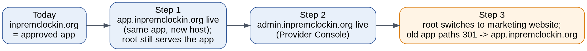

1.  Create DNS records and TLS certificates for app. and admin..

2.  Deploy the App site at app.inpremclockin.org. The root domain keeps serving the approved app until the marketing website is ready, so nothing breaks.

3.  Deploy the Admin site at admin.inpremclockin.org behind the IP allow-list.

4.  Update kiosk devices and bookmarks to app.inpremclockin.org; tell the existing organization.

5.  When the web team is ready, the root domain switches to the marketing website. Old application paths (/backoffice, /Identity/Account/Login, kiosk paths and the rest) redirect permanently (301) to the same path on app.inpremclockin.org. The web team adds these redirect rules on their hosting, or the App site keeps answering the root for those paths only.

# 3. Architecture for new code (unchanged from 0.3)

New code follows a layered structure (Clean Architecture): **Domain** holds business rules, **Application** holds use cases and interfaces, **Infrastructure** implements database, PayPal, Twilio, email and jobs, and the **web layer** (pages and API endpoints) stays thin. Arrows point inwards only, so business rules can be tested without the database or outside services.

**Diagram: Solution structure. The approved web project hosts the new areas; its existing pages are not restructured.**

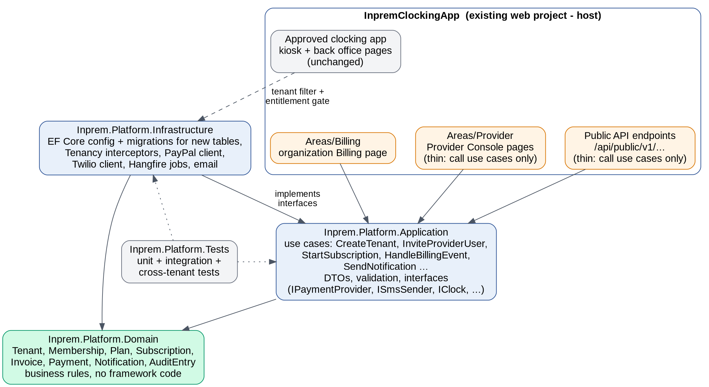

The same web project is deployed twice (Section 2.2): Areas/Provider is mapped only on the Admin site; the approved pages, Areas/Billing, the website API and webhooks only on the App site.

| **Practice**                    | **Applied to all new code**                                                                       |
|---------------------------------|---------------------------------------------------------------------------------------------------|
| Thin pages and endpoints        | One use case per page handler or endpoint; no DbContext in new pages                              |
| Interfaces for outside services | IPaymentProvider, ISmsSender, IOtpService, IEmailSender, IClock, IAuditLog                        |
| DTOs and validation             | Separate input/output models; one validation rule set shared by pages and API                     |
| Options and secrets             | Typed options validated at startup; secrets only in the host's secret store                       |
| Errors and logs                 | ProblemDetails JSON for API errors; structured logs with tenant and request ids, no personal data |
| Background jobs                 | Hangfire with SQL Server storage                                                                  |
| Quality gates                   | Pull requests, CTO review, automated tests and scans in CI (Section 12)                           |

# 4. Tenancy model (unchanged from 0.3)

- **Shared database**, TenantId on every tenant-owned row (already present on the branch).

- **One account per person** (email unique across the platform) and a TenantMemberships table linking a person to an organization with a role. Existing admins get a membership from their current TenantId; their passwords are untouched.

- **Tenant resolution** from the signed-in membership, re-checked on every request. Approved page addresses do not change.

- **Isolation:** existing query filters kept; user filter made fail-closed; save interceptor blocks cross-tenant edits and deletes; composite foreign keys; optional row-level security.

**Diagram: How a signed-in request is tied to one organization.**

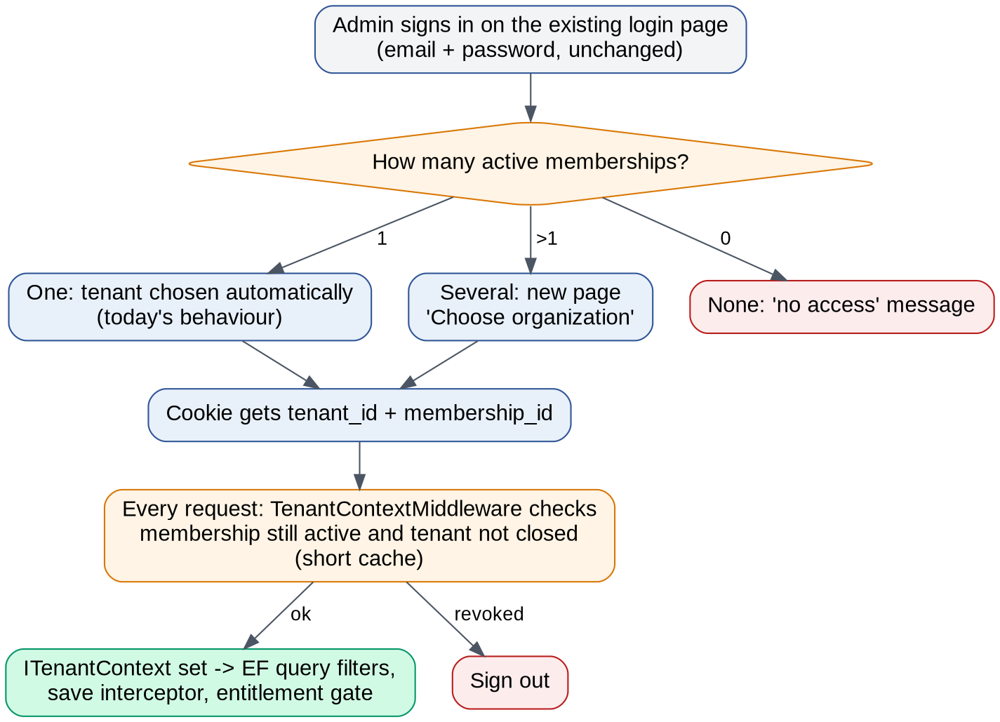

# 5. Provider accounts: bootstrap and recovery

## 5.1 Principles

- No email or password for any account is stored in code, appsettings.json, server variables or the repository.

- Every person sets their own password and enrols two-factor authentication before reaching the Provider Console.

- Privileged recovery needs **two independent things**: access to the server and a one-time code from the secret store, held by different people where possible.

- Every bootstrap or recovery action is audited and announced to all Provider Owners and a security mailbox.

## 5.2 First Provider Owner (bootstrap)

**Diagram: Creating the first Provider Owner.**

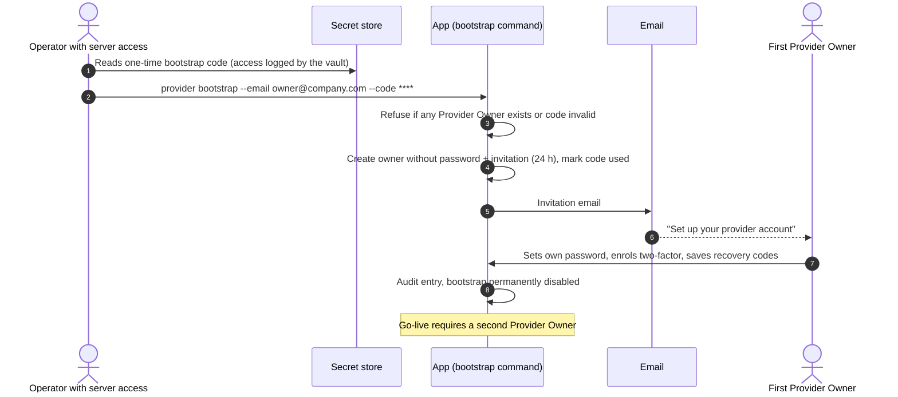

1.  Before deployment, the CTO creates a one-time **bootstrap code** in the secret store (for example Azure Key Vault). Reading it is logged by the vault.

2.  An operator with server access runs provider bootstrap --email \<address\> --code \<code\>. The command refuses to run if a Provider Owner already exists, if the code is wrong or used, or if the email is not a valid address.

3.  The command creates the account **without a password** and emails a one-time invitation valid for 24 hours. It prints only a confirmation, never the link.

4.  The owner sets a password, enrols an authenticator app and stores the ten recovery codes offline. Until then the console is unreachable.

5.  The code is marked used, bootstrap is permanently disabled, and the CTO deletes the code from the vault.

6.  **Go-live gate:** a second Provider Owner must be invited and fully enrolled before production go-live. The console shows a warning while only one owner exists.

## 5.3 Recovery levels

**Diagram: Choosing the right recovery level.**

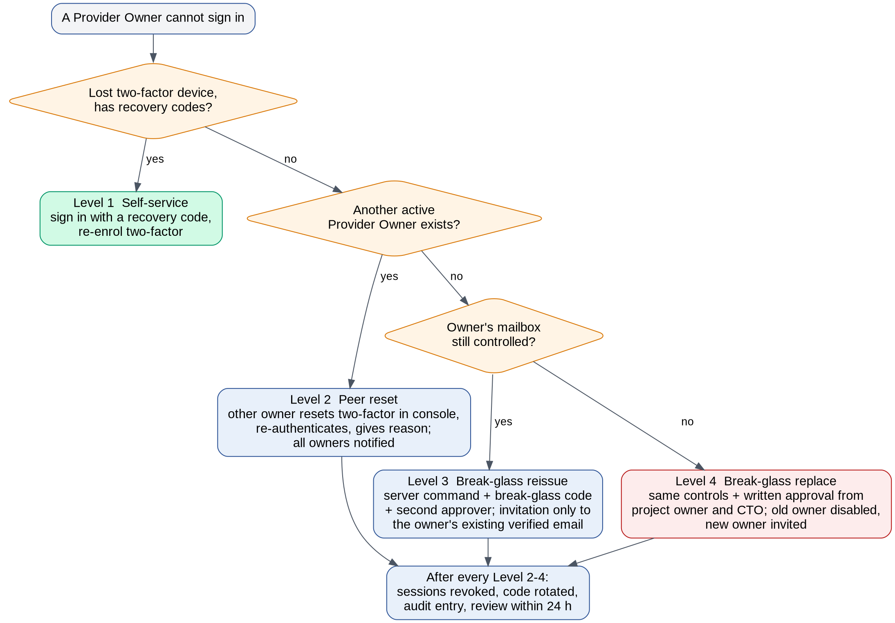

| **Level**             | **Situation**                                                  | **Procedure**                                                                                                                                                                                                              | **Controls**                                                                                                                      |
|-----------------------|----------------------------------------------------------------|----------------------------------------------------------------------------------------------------------------------------------------------------------------------------------------------------------------------------|-----------------------------------------------------------------------------------------------------------------------------------|
| 1 Self-service        | Lost authenticator, still has recovery codes                   | Sign in with a recovery code, then re-enrol two-factor and generate new codes                                                                                                                                              | Audit entry; email to the owner                                                                                                   |
| 2 Peer reset          | Lost authenticator and codes; another owner is active          | Another Provider Owner resets the person's two-factor from the console after re-entering their own code and giving a reason; the person re-enrols at next sign-in                                                          | Owners cannot reset themselves; all owners and the security mailbox notified; audit entry                                         |
| 3 Break-glass reissue | No other owner can act; the owner still controls their mailbox | Operator runs provider recover --user \<existing owner email\> --code \<break-glass code\> --approver \<second person\>. Sends a 1-hour invitation to the **existing verified email only**, resets password and two-factor | Server access + break-glass code + named second approver who confirms by email link within 1 hour; sessions revoked; code rotated |
| 4 Break-glass replace | Owner left or lost the mailbox                                 | Same command with --replace --new-email \<address\> after written approval from the project owner and the CTO; old owner disabled, new owner invited                                                                       | All Level 3 controls + written approval stored with the audit entry; 24-hour delay unless both approvers waive it                 |

## 5.4 Safeguards for every recovery

- **Break-glass code**: a separate one-time secret in the vault, readable only by the CTO and the project owner. Rotated after any use and every six months.

- **Cannot widen access**: recovery never creates a new owner silently; Level 3 only re-invites the existing person, Level 4 needs written approval.

- **Rate-limited**: at most one recovery per account per 24 hours; repeated failures lock the command for 24 hours and alert owners.

- **Everything revoked**: all sessions, remember-me cookies and pending invitations for that account; the security stamp is rotated.

- **Notification**: email to all Provider Owners and the security mailbox, and SMS where configured, naming the operator, level and reason.

- **Review**: a recovery report is completed within 24 hours (who, why, what changed); the CTO signs it.

- **Drills**: Levels 1 to 3 are practised on staging every six months and before go-live; the timing and result are recorded.

- **Dry run**: --dry-run shows what would happen without changing anything.

## 5.5 Other provider security

- Provider Console only on admin.inpremclockin.org, behind an IP allow-list, with its own login page and host-only cookie; lockout after 5 failed attempts for 15 minutes; sessions of 8 hours maximum, 30 minutes idle.

- Re-authentication before refunds, deleting an organization, changing PayPal or Twilio settings, inviting provider users or resetting another owner.

- Roles: Provider Owner, Provider Billing, Provider Support (permission matrix unchanged from 0.3).

# 6. Provider Console (served at admin.inpremclockin.org)

Screens: Dashboard, Organizations, Organization detail (tabs), Plans and pricing, Billing, Webhook events, Notifications, Jobs, Audit log, Provider users, Settings, and time-limited audited support sessions.

**Diagram: Page pattern: list → detail → separate create and edit pages. No forms on top of tables.**

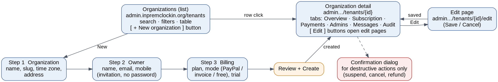

- List pages have search, filters, a table and a **+ New** button, never a create form.

- Create and edit open their own pages; long forms become a short wizard; Post/Redirect/Get after saving.

- Pop-ups only to confirm destructive actions.

# 7. Website integration: registration and subscriptions

The marketing website, built by a separate web team, must support both **public registration** (creating a new organization) and **subscription activities** (subscribing, converting a trial, changing plan, cancelling and resubscribing). It does this only through our API. The website never sees passwords, card details or PayPal credentials.

## 7.1 Customer journeys

**Diagram: Customer journeys supported by the website.**

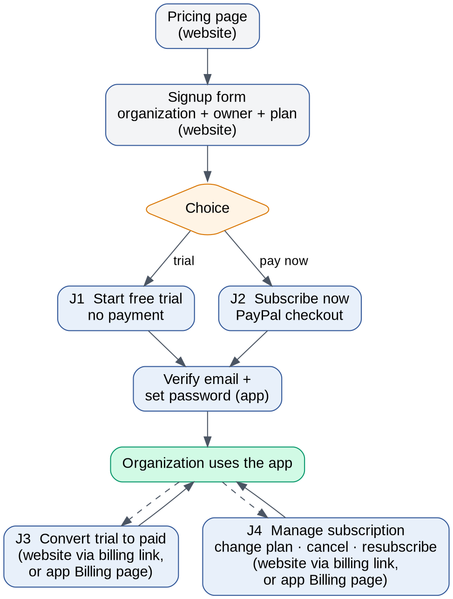

| **Journey**                        | **Steps**                                                                                                                                                                       | **Result**                                                                              |
|------------------------------------|---------------------------------------------------------------------------------------------------------------------------------------------------------------------------------|-----------------------------------------------------------------------------------------|
| J1 Register with free trial        | Pricing → signup form (organization, owner, plan) → submit → “Check your email” → owner verifies email and sets password in the app                                             | Organization in Trialing; no payment taken                                              |
| J2 Register and subscribe now      | Pricing → signup form → submit → redirected to PayPal → approves → back on the website status page → “Subscription active, check your email” → owner verifies and sets password | Organization Active and paid                                                            |
| J3 Convert trial to paid           | “Manage subscription” on the website → enters owner email → one-time link by email → chooses plan → PayPal → status page; or the same from the in-app Billing page              | Trialing → Active                                                                       |
| J4 Manage an existing subscription | Same access as J3 → view plan and status → change plan (PayPal approval), cancel at period end, or resubscribe after cancellation, expiry or suspension                         | Plan changed, Canceled, or Active again                                                 |
| J5 Abandoned or cancelled checkout | Buyer closes PayPal or presses cancel                                                                                                                                           | Checkout Cancelled or Expired; organization stays as it was; website offers “Try again” |
| J6 Payment problem                 | PayPal declines or the subscription does not become active                                                                                                                      | Checkout Failed; organization not activated; website shows next steps; provider alerted |

## 7.2 How the website is authorised

| **Caller situation**                       | **Credential**                                           | **Lifetime and scope**                                                                 |
|--------------------------------------------|----------------------------------------------------------|----------------------------------------------------------------------------------------|
| Anyone browsing                            | None (public endpoints)                                  | Read-only, no personal data, rate-limited                                              |
| Visitor who just submitted the signup form | signupToken returned by POST /signups                    | 2 hours; only that signup and its checkouts                                            |
| Existing organization owner on the website | billingAccessToken obtained from a one-time emailed link | 30 minutes; billing actions for that one organization only                             |
| The website's own server (optional)        | API key in the X-Api-Key header                          | Identifies the website for higher rate limits; never a substitute for the tokens above |

Tokens are opaque random values, stored only as hashes, sent as Authorization: Bearer \<token\>, and never placed in URLs except the one-time email code, which is exchanged immediately.

## 7.3 Endpoints (version 1)

Base URL: https://app.inpremclockin.org/api/public/v1 (staging: the App site's staging hostname). Paths below show the full path for clarity.

| **Method and path**                                        | **Auth**                                            | **Purpose and main response**                                                                                                                                                                                                                 |
|------------------------------------------------------------|-----------------------------------------------------|-----------------------------------------------------------------------------------------------------------------------------------------------------------------------------------------------------------------------------------------------|
| GET /api/public/v1/plans                                   | None                                                | Plans, prices per cycle, currency, features, limits, trial length; cacheable                                                                                                                                                                  |
| GET /api/public/v1/timezones                               | None                                                | Supported time zones                                                                                                                                                                                                                          |
| GET /api/public/v1/slugs/{slug}/availability               | None                                                | { available, suggestion }; rate-limited                                                                                                                                                                                                       |
| POST /api/public/v1/signups                                | CAPTCHA + Idempotency-Key                           | Body: organization name, slug, time zone, owner name, email, mobile (optional), consent flags, planPriceId, mode = trial or subscribe. Returns 201 { signupId, signupToken, status, nextAction } where nextAction is verify_email or checkout |
| GET /api/public/v1/signups/{signupId}                      | signupToken                                         | { status: PendingVerification \| Verified \| Active, subscriptionStatus }                                                                                                                                                                     |
| POST /api/public/v1/signups/{signupId}/resend-verification | signupToken                                         | Resends the verification email (max 3 per hour)                                                                                                                                                                                               |
| POST /api/public/v1/checkout-sessions                      | signupToken or billingAccessToken + Idempotency-Key | Body: planPriceId, purpose = new \| convert \| resubscribe \| change_plan, returnUrl, cancelUrl (must match the allow-list). Returns 201 { checkoutSessionId, approvalUrl, expiresAt }                                                        |
| GET /api/public/v1/checkout-sessions/{id}                  | Same token                                          | { status, subscriptionStatus, plan, nextBillingDate, message }                                                                                                                                                                                |
| POST /api/public/v1/checkout-sessions/{id}/confirm         | Same token                                          | Called after PayPal returns the buyer. Server fetches the subscription from PayPal, verifies it and returns the new status. Safe to repeat                                                                                                    |
| POST /api/public/v1/checkout-sessions/{id}/cancel          | Same token                                          | Marks the checkout Cancelled when the buyer returns via the cancel URL                                                                                                                                                                        |
| POST /api/public/v1/billing-access/requests                | CAPTCHA                                             | Body: email. Always 202; if the email belongs to an organization owner, emails a one-time link (15 minutes)                                                                                                                                   |
| POST /api/public/v1/billing-access/sessions                | One-time code                                       | Exchanges the emailed code for a billingAccessToken (30 minutes)                                                                                                                                                                              |
| GET /api/public/v1/account/subscription                    | billingAccessToken                                  | Plan, status, current period end, cancel-at-period-end flag, outstanding balance                                                                                                                                                              |
| GET /api/public/v1/account/invoices                        | billingAccessToken                                  | Invoices with amounts, status and PayPal payment links                                                                                                                                                                                        |
| POST /api/public/v1/account/subscription/cancel            | billingAccessToken                                  | Cancels at the end of the paid period; returns the end date                                                                                                                                                                                   |
| POST /api/public/v1/account/subscription/keep              | billingAccessToken                                  | Withdraws a pending cancellation if PayPal still allows it                                                                                                                                                                                    |
| GET /api/public/v1/health                                  | None                                                | Liveness only                                                                                                                                                                                                                                 |

Converting, resubscribing and changing plan all use POST /checkout-sessions with the matching purpose, so the website implements one checkout flow. Changing plan uses PayPal's subscription revision, which the payer approves in the same way.

## 7.4 PayPal checkout flow

**Diagram: Journey J2: register and subscribe from the website.**

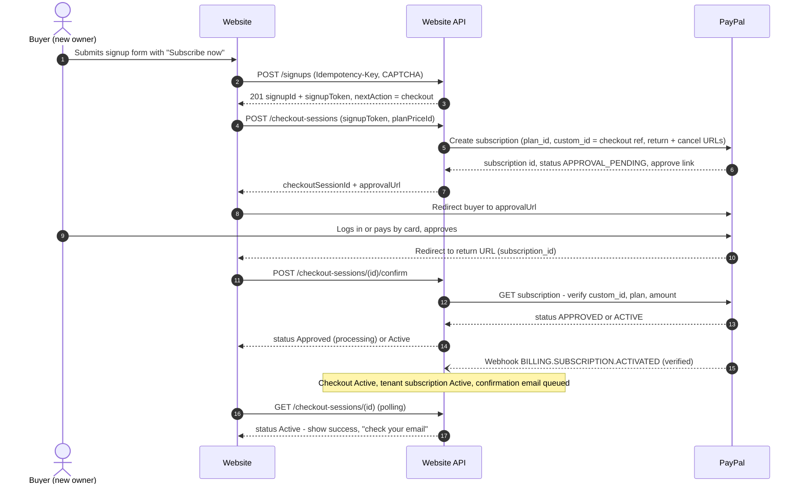

1.  The website calls POST /checkout-sessions. Our server looks up the PayPal plan id from its own catalogue (the website only sends our planPriceId), creates a checkout session, and creates a PayPal subscription with custom_id set to the checkout-session reference and the allow-listed return and cancel URLs.

2.  PayPal returns the subscription id, status APPROVAL_PENDING and an approve link. Our server stores the subscription id against the checkout session and returns the approve link as approvalUrl.

3.  The website redirects the buyer to approvalUrl. The buyer logs in to PayPal or pays by card and approves.

4.  PayPal redirects the buyer to the website's return URL. The website shows “Confirming your subscription…” and calls POST /checkout-sessions/{id}/confirm.

5.  Our server fetches the subscription from PayPal and checks it (Section 7.5). The website then polls GET /checkout-sessions/{id} until the status is final.

6.  When the subscription is Active, the organization is activated, a confirmation email is queued, and the website shows success and asks the owner to check their email to set a password.

> **To verify during implementation:** PayPal's create-subscription reference still documents return_url and cancel_url inside application_context but marks that object deprecated without naming a replacement. Confirm the current field with PayPal's documentation or support before Phase 2. If the website team prefers PayPal's JavaScript button, it can be used instead of the redirect, provided the button's custom_id is the checkout-session reference returned by our API and confirmation still goes through /confirm.

## 7.5 Subscription-status confirmation

The website must never show “success” just because PayPal sent the buyer back. An organization becomes Active only when PayPal itself reports the subscription as ACTIVE, through one of three independent sources:

| **Source**             | **When**                                                         | **What the server does**                                                            |
|------------------------|------------------------------------------------------------------|-------------------------------------------------------------------------------------|
| 1\. Confirm call       | Website calls /confirm after the redirect                        | Fetches the subscription from PayPal's API                                          |
| 2\. Webhook            | PayPal sends BILLING.SUBSCRIPTION.ACTIVATED (signature verified) | Fetches the subscription again, then applies it                                     |
| 3\. Reconciliation job | Every 5 minutes for open checkouts, daily for all subscriptions  | Fetches any checkout still Approved and any subscription that disagrees with PayPal |

Before activating, the server checks: custom_id equals this checkout session; plan_id is the plan the session was created for; amount and currency match our catalogue; the PayPal subscription id is not linked to any other organization; and the session has not expired. Any mismatch marks the checkout Failed and alerts the provider. All three sources call the same idempotent use case, so activation happens exactly once.

**Diagram: Checkout-session states.**

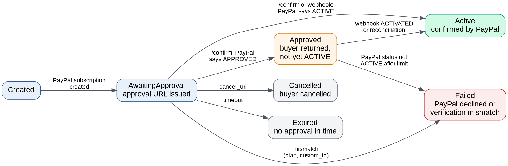

| **Status returned to the website** | **Website shows**                                                                         | **Polling**                                                           |
|------------------------------------|-------------------------------------------------------------------------------------------|-----------------------------------------------------------------------|
| AwaitingApproval                   | Button to continue to PayPal                                                              | None                                                                  |
| Approved                           | “Confirming your subscription…”                                                           | Every 2 seconds for 30 seconds, then every 10 seconds up to 2 minutes |
| Active                             | Success; “check your email to set your password” (or “go to the app” for existing owners) | Stop                                                                  |
| Approved after 2 minutes           | “Payment received, activation is taking longer than usual. We will email you.”            | Stop; reconciliation continues                                        |
| Cancelled / Expired                | “Checkout was not completed” and Try again                                                | Stop                                                                  |
| Failed                             | “We could not activate your subscription” and a support contact                           | Stop                                                                  |

## 7.6 Existing customers on the website

**Diagram: Journeys J3 and J4: an owner manages billing from the website without a password.**

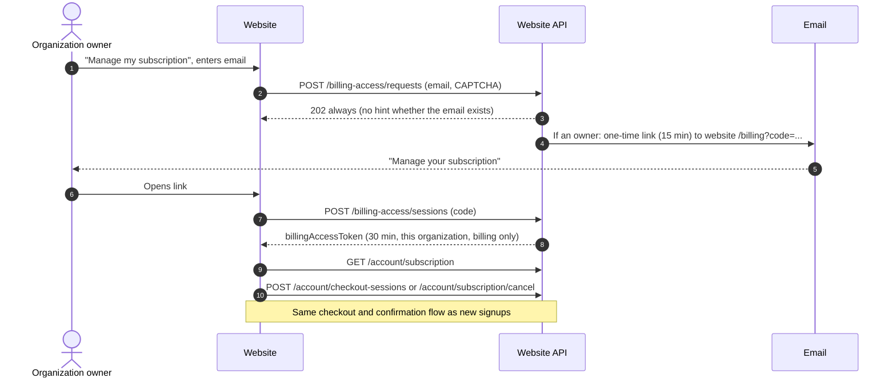

The response to billing-access/requests is identical whether or not the email exists, so the API cannot be used to discover customers. Only members with the Owner role receive a link. Owners can always do the same from the in-app Billing page while signed in.

## 7.7 API rules

| **Topic**              | **Rule**                                                                                                                                |
|------------------------|-----------------------------------------------------------------------------------------------------------------------------------------|
| Versioning             | Path versioning (/v1); breaking changes only in /v2, with /v1 kept for an agreed period                                                 |
| Documentation          | OpenAPI description generated from the code, published at /api/public/docs on staging, with example requests                            |
| CORS                   | Only https://inpremclockin.org, https://www.inpremclockin.org and the staging website origin                                            |
| Return and cancel URLs | Must start with an allow-listed website origin configured on the server                                                                 |
| Rate limits            | Per IP and per token; 429 with Retry-After when exceeded                                                                                |
| CAPTCHA                | Required on signup and billing-access requests; verified on the server                                                                  |
| Idempotency            | Idempotency-Key on signup and checkout creation; the same key returns the same result for 24 hours                                      |
| Errors                 | ProblemDetails JSON with field-level validation errors and stable error codes                                                           |
| Privacy                | Public endpoints never return personal data; the signup response contains only ids, status and next action                              |
| Environments           | Staging API with PayPal sandbox for the web team; production keys only after their integration passes the tests in Section 13 (Phase 3) |

# 8. PayPal billing (unchanged except where noted)

- **Subscriptions** for automatic renewals, created by our server (changed in 0.4) and started either from the website or the in-app Billing page.

- **PayPal Invoicing** for special cases and **offline payments** recorded in the console.

- **Webhooks** verified with PayPal's verify-webhook-signature API, stored once by event id, processed by background jobs that re-fetch from PayPal; daily reconciliation.

- **Failed payments** follow PayPal's retry and payment_failure_threshold behaviour; suspended or expired organizations become read-only but can still report and export.

- **SDK**: PayPalServerSDK for subscriptions; a typed HTTP client for Invoicing and webhook verification.

**Diagram: Organization subscription states and the PayPal events that move between them.**

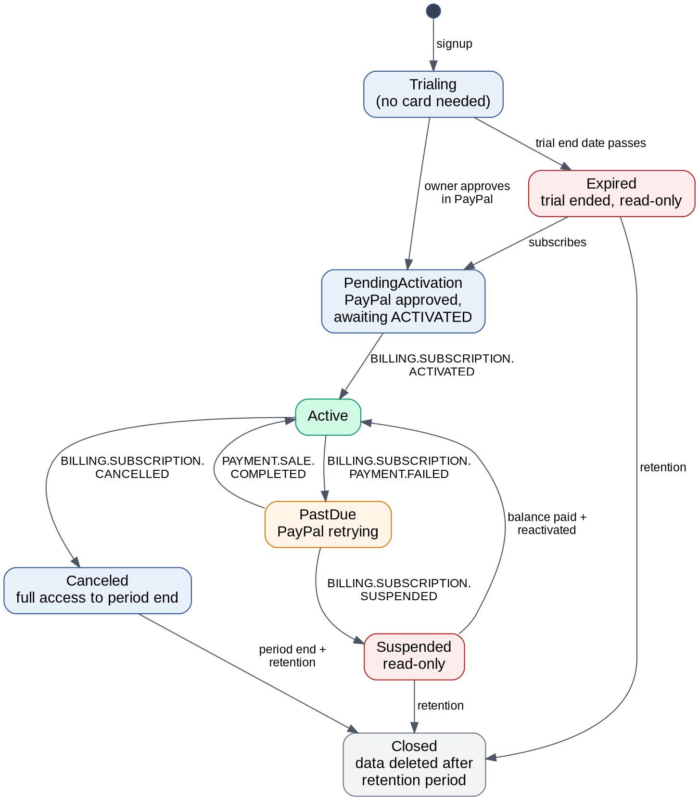

**Diagram: Processing a PayPal webhook safely.**

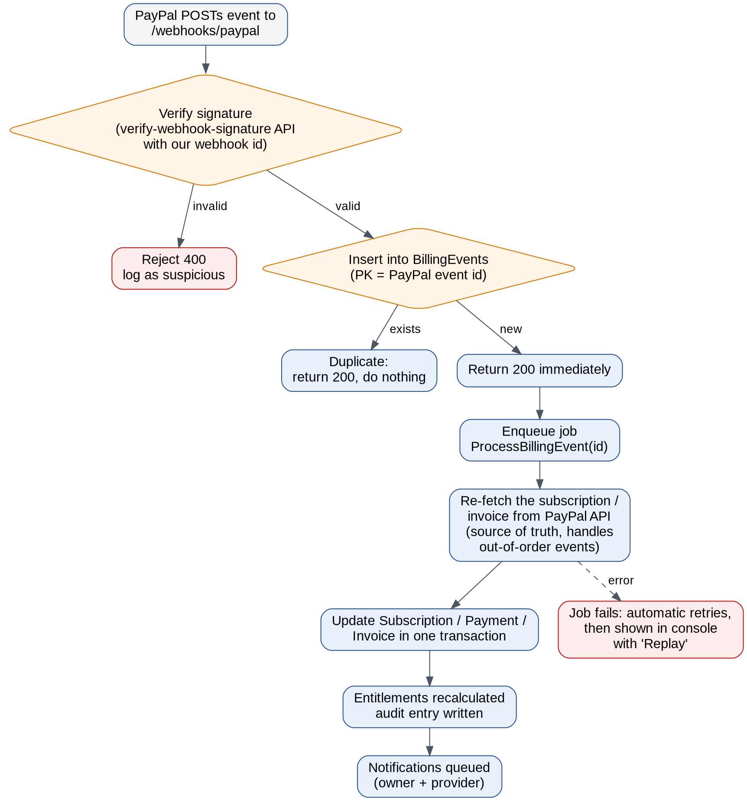

# 9. Twilio alerts (unchanged from 0.3)

- Login codes through Twilio Verify; billing and provider alerts through one notification module with consent, quiet hours, spend limits and delivery tracking.

- Staff and volunteer alerts only with recorded opt-in and owner approval (change-control item C3-6).

- US sender registration (toll-free verification or A2P 10DLC) started early.

**Diagram: Notification pipeline.**

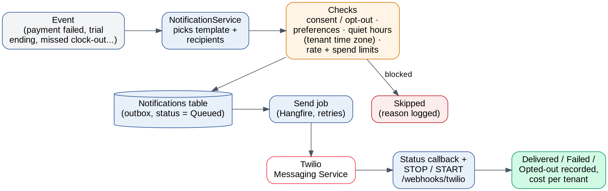

# 10. Change control for existing files

Every existing file on the baseline commit falls into one of four categories. A file not listed in C2, C3 or C4 is in C1 and must not change.

| **Category**       | **Meaning**                                                                                        | **Who approves**                                  |
|--------------------|----------------------------------------------------------------------------------------------------|---------------------------------------------------|
| C1 Frozen          | Must not change at all                                                                             | Nobody; a change requires a design revision       |
| C2 Internal change | May change only in the stated way; users see no difference; proven by the behaviour baseline tests | CTO in code review                                |
| C3 Visible change  | Small, stated additions users can see                                                              | Project owner in writing, then CTO in code review |
| C4 Replaced        | Rejected multi-tenancy code, removed after its replacement works                                   | CTO                                               |

## 10.1 C1: frozen

- **Pages:** all files in Pages/ except those named in C2 to C4, including the kiosk pages (StaffAttendance, VolunteerAttendance, StaffClockPage, VolunteerClockPage), back-office pages (BackOffice, Staff, Volunteer, details, clocking, reports, HoursWorked, User), Index, Privacy, Error and all shared partials and layouts except \_Sidebar.cshtml and \_MainLayout.cshtml.

- **Controllers:** ControlsController, PeopleController (both), SearchController, StaffController, ReportsController, Api/StaffReportsController, Api/VolunteerReportsController.

- **Services:** StaffService, VolunteerService, StaffClockingService, VolunteerClockingService, EmailService.

- **Models and helpers:** Staff, Volunteer, Clocking, ClockingStaff, view models, PdfTableStyle, PrivacyMask, RosterExport, VolunteerCategoryValidation, WorkingHoursFormat.

- **Front end:** everything in wwwroot/.

- **Identity UI:** all Areas/Identity pages except the three named in C2.

- **Existing migrations:** files in Migrations/ up to AddVolunteerContactPersonDetails are never edited; only new migrations are added.

## 10.2 C2: internal changes only

| **\#** | **File**                                                  | **Allowed change**                                                                                                                                                                                                                             | **Behaviour that must stay identical**                                          |
|--------|-----------------------------------------------------------|------------------------------------------------------------------------------------------------------------------------------------------------------------------------------------------------------------------------------------------------|---------------------------------------------------------------------------------|
| C2-1   | Data/ApplicationDbContext.cs                              | User filter fails closed; register save interceptor; composite foreign-key configuration; Identity index change for platform-unique email                                                                                                      | Every query in the approved app returns the same rows for a signed-in admin     |
| C2-2   | Program.cs                                                | Register new projects, SiteMode and host-based mapping, memberships middleware, Hangfire (server only when enabled), website API, CORS, rate limiting, data-protection key storage, host-only cookie settings; remove BillingBackgroundService | All approved routes, policies and the admin-only page list unchanged            |
| C2-3   | Areas/Identity/Pages/Account/Login.cshtml.cs              | Remove the pick-account-by-password logic; standard Identity sign-in; after sign-in, redirect to “Choose organization” only when more than one membership exists                                                                               | Same page, fields, messages and default redirect for single-organization admins |
| C2-4   | ForgotPassword.cshtml.cs, ResetPassword.cshtml.cs         | Remove multi-account reset logic                                                                                                                                                                                                               | Same pages, emails and messages                                                 |
| C2-5   | Helpers/IdentitySeeder.cs                                 | Remove SeedAdmin and SeedSuperAdmin account creation; keep role creation                                                                                                                                                                       | Roles unchanged                                                                 |
| C2-6   | Services/AuthService.cs                                   | CreateAdmin also creates a membership in the current organization                                                                                                                                                                              | Admins page creates admins exactly as today for new emails                      |
| C2-7   | Services/AppUserClaimsPrincipalFactory.cs                 | Add membership_id claim; tenant_id taken from the membership                                                                                                                                                                                   | Same claims for existing pages                                                  |
| C2-8   | Services/CurrentTenantService.cs                          | Read the tenant from the validated membership context instead of the raw claim                                                                                                                                                                 | Same tenant for every existing request                                          |
| C2-9   | Services/TenantClock.cs, Services/CurrentTenantProfile.cs | Read the tenant from ITenantContext; Windows time-zone fallback                                                                                                                                                                                | Same times, dates and PDF headers                                               |
| C2-10  | Helpers/TenantAwareUserValidator.cs                       | Replaced by platform-wide unique email validation                                                                                                                                                                                              | No change for new, unique emails                                                |
| C2-11  | appsettings.json                                          | Add non-secret settings (allowed origins, feature flags); keep Platform:Operator\*                                                                                                                                                             | None                                                                            |

## 10.3 C3: visible changes needing the project owner's approval

| **\#** | **File or area**                       | **Visible change**                                                                                                     | **Needed for**            | **Required?**                                    |
|--------|----------------------------------------|------------------------------------------------------------------------------------------------------------------------|---------------------------|--------------------------------------------------|
| C3-1   | Pages/Shared/\_Sidebar.cshtml          | Remove SuperAdmin Tenants and Invoices links; add Billing for organization owners                                      | Provider Console, billing | Yes                                              |
| C3-2   | Pages/Shared/\_MainLayout.cshtml       | One partial include for a status banner (trial days left, payment problem, read-only)                                  | Billing                   | Yes                                              |
| C3-3   | Global filter (no page edits)          | Saves blocked with a clear message when the subscription is Suspended or Expired; reports and exports still work       | Billing enforcement       | Yes                                              |
| C3-4   | Kiosk entry (filter)                   | Kiosk cannot be used when Suspended or Expired                                                                         | Billing enforcement       | Yes                                              |
| C3-5   | New page after login                   | “Choose organization” for people with more than one membership                                                         | Memberships               | Yes                                              |
| C3-6   | Admins page message                    | Adding an email that already has an account sends an invitation and shows a different confirmation message             | Memberships               | Yes                                              |
| C3-7   | Login lockout                          | Account locked for 15 minutes after 5 failed attempts                                                                  | Security                  | Recommended                                      |
| C3-8   | Staff and volunteer registration forms | Optional mobile number and SMS consent checkbox                                                                        | Phase 6 alerts            | Optional                                         |
| C3-9   | Kiosk session                          | Kiosk cannot open the back office; automatic end-of-day sign-out                                                       | Security                  | Optional, recommended                            |
| C3-10  | Anti-forgery                           | Re-enable validation for all forms and send the token from jQuery calls                                                | Security                  | Optional, recommended; needs full regression run |
| C3-11  | Hostname                               | Approved app served at app.inpremclockin.org; old root paths redirect permanently; kiosk devices and bookmarks updated | CTO hostname decision     | Yes                                              |

## 10.4 C4: replaced

- Pages/Platform/Tenants, TenantDetail, Invoices (and their .cs files) → Provider Console area.

- Controllers/Api/InvoicesController.cs → Provider Console billing endpoints.

- Services/TenantAdminService.cs, BillingService.cs, BillingBackgroundService.cs → platform use cases and Hangfire jobs.

- Models/Billing/\* → platform domain entities. The existing Subscriptions and Invoices tables are retired only in a later contract migration (Section 11.5).

## 10.5 Rules for any C2 or C3 change

1.  **Baseline first.** Before Phase 0 code changes, the behaviour baseline suite (Section 12.1) is written against the unchanged baseline commit and must pass.

2.  **Small pull requests** labelled touches-approved-app, one C2 or C3 item each where practical, linked to its register number.

3.  **Proof of no change:** the baseline suite passes unchanged; screenshots of affected pages before and after are attached; for C3 items, the owner's written approval is attached.

4.  **No drive-by edits:** formatting, renaming or refactoring of C1 files is not allowed in this project.

5.  **Revert plan:** each C2 or C3 pull request can be reverted on its own without breaking the others.

# 11. Database inspection, migration, backup and rollback

No schema change is applied to any shared or production database until steps 1 to 4 below are complete and the CTO has signed the checklist.

**Diagram: Procedure for every schema change.**

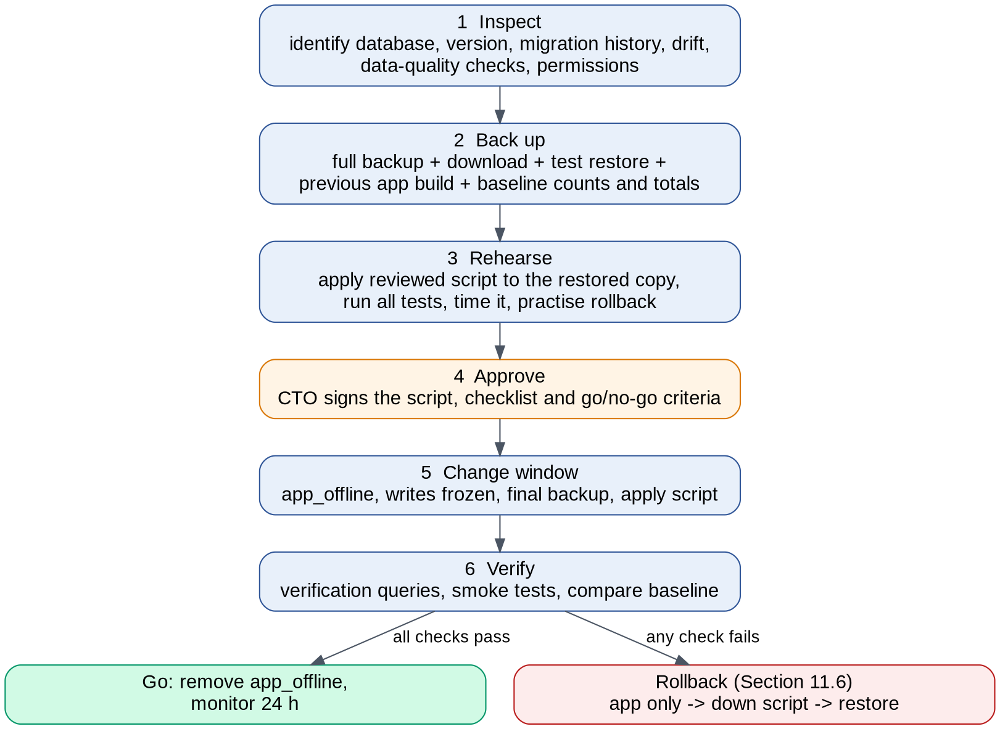

## 11.1 Step 1: inspect

| **Check**                   | **How**                                                                                                                | **Pass condition**                                                                                       |
|-----------------------------|------------------------------------------------------------------------------------------------------------------------|----------------------------------------------------------------------------------------------------------|
| Correct database            | Server name, database name, SELECT @@VERSION, compatibility level, recovery model, size                                | Recorded; SQL Server 2016 or later                                                                       |
| Migration history           | SELECT MigrationId FROM \_\_EFMigrationsHistory ORDER BY MigrationId                                                   | Matches the baseline commit's migrations exactly (last: 20261003091001_AddVolunteerContactPersonDetails) |
| Model drift                 | dotnet ef migrations has-pending-model-changes on the baseline commit (available from EF Core 8)                       | No pending changes                                                                                       |
| Schema drift                | Compare the live schema with a script generated from migrations (for example with SqlPackage or a schema-compare tool) | No unexplained differences                                                                               |
| Data is test-only           | Row counts per table; sample review with the project owner                                                             | Project owner confirms in writing                                                                        |
| Duplicate admin emails      | Group AspNetUsers by NormalizedEmail having more than one row                                                          | Zero, or each duplicate resolved before the unique-email migration                                       |
| Users without organization  | AspNetUsers with null TenantId that are not SuperAdmins                                                                | Zero or explained                                                                                        |
| Cross-tenant references     | Clockings whose person belongs to a different TenantId                                                                 | Zero (required before composite foreign keys)                                                            |
| Duplicate clockings per day | Group by tenant, person and local date                                                                                 | Zero (existing unique index should guarantee it)                                                         |
| Old billing tables          | Row counts of Subscriptions and Invoices                                                                               | Recorded for the contract step                                                                           |
| Permissions                 | IS_ROLEMEMBER('db_owner'), HAS_PERMS_BY_NAME(..., 'ALTER ANY SECURITY POLICY')                                         | Recorded; decides row-level security                                                                     |

*Inspection queries (table and column names to be confirmed against the schema)*

> -- Examples (read-only)
>
> SELECT NormalizedEmail, COUNT(\*) AS Accounts
>
> FROM dbo.AspNetUsers GROUP BY NormalizedEmail HAVING COUNT(\*) \> 1;
>
> SELECT c.Id FROM dbo.ClockingsStaff c JOIN dbo.Staffs s ON s.Id = c.StaffId
>
> WHERE c.TenantId \<\> s.TenantId; -- repeat for volunteers
>
> SELECT t.name, SUM(p.rows) AS Rows FROM sys.tables t
>
> JOIN sys.partitions p ON p.object_id = t.object_id AND p.index_id IN (0,1)
>
> GROUP BY t.name ORDER BY t.name;

## 11.2 Step 2: back up

1.  Take a full backup from the host's control panel (or BACKUP DATABASE ... WITH COPY_ONLY, CHECKSUM where permitted) and download it to secure storage.

2.  Record the file name, size, checksum (SHA-256) and time.

3.  **Prove the backup works**: restore it to a separate rehearsal database and run the row-count query; counts must match step 1.

4.  Save the currently deployed application build (Web Deploy package or folder copy) so it can be redeployed unchanged.

5.  Record the baseline: row counts per table and the totals of three agreed reports (for example last month's staff and volunteer hours).

6.  Keep the backup for at least 30 days after the change, or longer if the project owner requires.

## 11.3 Step 3: rehearse

- Generate the script with dotnet ef migrations script \<last applied\> \<new\> --idempotent, then add guards: stop on first error, refuse to run unless the expected last migration is present, and SQLCMD-mode check (the pattern already used in scripts/prod-upgrade.sql).

- Run it against the rehearsal database; run the full test suite and the behaviour baseline against an app pointed at it.

- Time the run; it must fit inside the planned window with at least 50% spare.

- Practise the rollback (Section 11.6) on the rehearsal database, including restoring the backup.

## 11.4 Step 4: approve; step 5: apply; step 6: verify

- **Approve:** CTO signs the reviewed script, inspection results, rehearsal timings and go/no-go criteria.

- **Apply:** announce the window; upload app_offline.htm (writes stop); take a final backup; run the script; deploy the new build.

- **Verify:** run the verification queries attached to each migration; compare row counts and report totals with the baseline; run the automated smoke tests; sign in as a test admin and a Provider Owner.

- **Go/no-go:** go only if every check passes; otherwise roll back immediately.

## 11.5 Migration sequence (expand, then contract)

| **Migration**      | **Change**                                                                                                                                                    | **Type**            | **Verification**                                    | **Down step**                           |
|--------------------|---------------------------------------------------------------------------------------------------------------------------------------------------------------|---------------------|-----------------------------------------------------|-----------------------------------------|
| M1 Platform tables | New tables for plans, prices, platform subscriptions, checkout sessions, payments, billing events, notifications, consent, audit, provider users, invitations | Additive            | Tables exist; old app unaffected                    | Drop the new tables (empty)             |
| M2 Memberships     | TenantMemberships created and filled from AspNetUsers.TenantId                                                                                                | Additive + backfill | One membership per tenant user; counts match        | Drop table                              |
| M3 Unique email    | Platform-wide unique index on NormalizedEmail; old per-tenant username indexes kept until M6                                                                  | Constraint          | Duplicate query returns zero                        | Drop the new index                      |
| M4 Composite keys  | Alternate keys (TenantId, Id) on people; composite foreign keys on clockings                                                                                  | Constraint          | Cross-tenant query returns zero; inserts still work | Drop new keys, restore old foreign keys |
| M5 Data copy       | Copy old Subscriptions / Invoices test rows to platform tables (or archive tables)                                                                            | Data                | Counts match                                        | Delete copied rows                      |
| M6 Contract        | Drop old billing tables and old indexes, only after one stable release                                                                                        | Destructive         | Approved separately                                 | Restore from backup only                |

Each release must work with both the previous and the new schema during the window, so rolling back the application alone is always possible for M1 to M5.

## 11.6 Rollback

| **Level**           | **When**                                         | **Action**                                                                                                    | **Data impact**                                                                |
|---------------------|--------------------------------------------------|---------------------------------------------------------------------------------------------------------------|--------------------------------------------------------------------------------|
| R1 Application only | New code fails but the schema change is additive | Redeploy the saved previous build                                                                             | None                                                                           |
| R2 Down script      | The schema change itself causes problems         | Run the reviewed down script prepared and rehearsed in step 3, then redeploy the previous build               | None, if run before new writes depend on new tables                            |
| R3 Restore          | Data damaged or R2 fails                         | Restore the final pre-change backup (or point-in-time restore on a managed host), redeploy the previous build | Writes after the backup are lost; the window keeps writes frozen to avoid this |

Decision maker: the CTO or a named deputy. Rollback is triggered by any failed verification check or by a production error rate above an agreed threshold within 24 hours. The same procedure applies if the database moves to a new host.

# 12. Automated tests and quality gates

All suites run in CI on every pull request against a real SQL Server instance. A pull request cannot be merged unless every required suite passes.

## 12.1 Test suites

| **Suite**              | **What it covers**                                                                                                                                                                                                                                                                         | **Required from**            |
|------------------------|--------------------------------------------------------------------------------------------------------------------------------------------------------------------------------------------------------------------------------------------------------------------------------------------|------------------------------|
| Behaviour baseline     | Approved app flows recorded on the baseline commit: kiosk register, search, clock in, break, clock out; back-office people, clockings, admins; report totals and PDF text for fixed test data. Runs unchanged on every later commit                                                        | Before Phase 0 changes       |
| Tenant isolation       | Two or more seeded organizations. For every route discovered from the app's endpoint table, organization A requests organization B's ids: response must be 403 or 404 and no row of B may change. Includes API controllers, page handlers, PDF downloads and website API account endpoints | Phase 0                      |
| Query-filter coverage  | Reflection test: every entity with a TenantId has a query filter and is covered by the save interceptor                                                                                                                                                                                    | Phase 0                      |
| Authorization matrix   | Every route × role (anonymous, kiosk, org admin, org owner, provider support, billing, owner): expected allow or deny                                                                                                                                                                      | Phase 0, extended each phase |
| Security               | Login lockout; no secrets in the repository (secret scanner); no vulnerable packages of high or critical severity; security headers; tokens expire; CAPTCHA required; rate limits return 429; CSRF where enabled; dynamic scan (for example OWASP ZAP baseline) on staging                 | Phase 0, extended each phase |
| Bootstrap and recovery | Bootstrap refuses when an owner exists or the code is wrong; each recovery level's controls; sessions revoked; notifications sent                                                                                                                                                          | Phase 0                      |
| Billing                | PayPal sandbox and fakes: every checkout status; duplicate, late and out-of-order webhooks; mismatched custom_id or plan; reconciliation                                                                                                                                                   | Phase 2                      |
| Website API contract   | OpenAPI document matches implementation; examples execute; idempotency; error format                                                                                                                                                                                                       | Phase 3                      |
| Migration              | Migrations apply to an empty database and to a copy of the baseline schema; down scripts work                                                                                                                                                                                              | Phase 0                      |
| Host isolation         | With SiteMode = App, every Provider Console route returns 404; with SiteMode = Admin, every back-office, kiosk, website API and webhook route returns 404; cookies are host-only; the Admin site does not start a job server                                                               | Phase 0                      |

# 13. Implementation phases and acceptance criteria

**Diagram: Phases in order.**

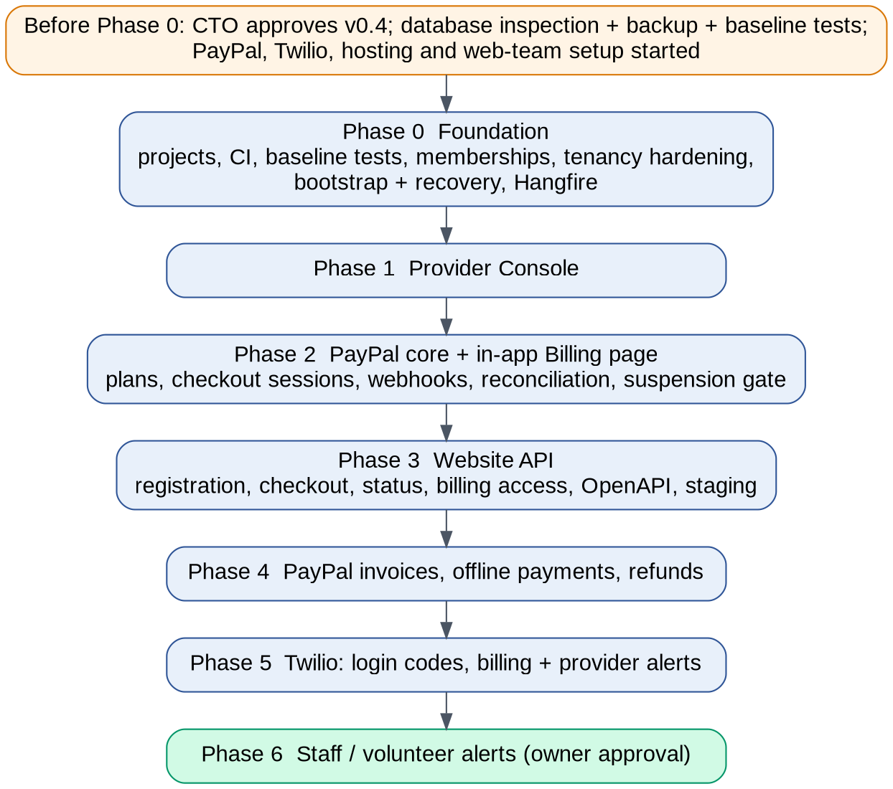

A phase is accepted only when every criterion is met and the CTO signs it off. Numbers are proposals for the CTO to confirm (Section 15).

## Before Phase 0 (gate G0)

| **ID** | **Criterion**                | **Measure**                                                        |
|--------|------------------------------|--------------------------------------------------------------------|
| G0-1   | Design v0.4 approved         | Written approval from the CTO and the project owner                |
| G0-2   | Database inspection complete | All checks in 11.1 recorded; test-data status confirmed in writing |
| G0-3   | Backup proven                | Restore to rehearsal database succeeded; counts match              |
| G0-4   | Behaviour baseline in place  | Baseline suite passes 100% on commit 1061ea8                       |

## Phase 0: Foundation

| **ID** | **Criterion**                    | **Measure**                                                                                                                            |
|--------|----------------------------------|----------------------------------------------------------------------------------------------------------------------------------------|
| P0-1   | Approved behaviour preserved     | Behaviour baseline suite 100% pass; report totals identical to baseline                                                                |
| P0-2   | Tenant isolation                 | Isolation suite covers 100% of routes in the endpoint table; 0 failures; 0 rows of another organization changed                        |
| P0-3   | Filter coverage                  | 100% of tenant-owned entities have a query filter and interceptor coverage                                                             |
| P0-4   | Memberships                      | Every existing tenant admin has exactly one active membership; single-organization admins sign in with no visible change               |
| P0-5   | No credentials in code or config | Secret scanner 0 findings; no SeedAdmin or SeedSuperAdmin keys read anywhere                                                           |
| P0-6   | Bootstrap and recovery           | Bootstrap and Levels 1–3 executed on staging and recorded; all safeguards tested automatically                                         |
| P0-7   | Security baseline                | 0 high or critical package vulnerabilities; lockout test passes (if C3-7 approved)                                                     |
| P0-8   | CI                               | Build and all required suites run on every pull request; median pipeline under 15 minutes                                              |
| P0-9   | Migrations M1–M4                 | Applied on staging through the full Section 11 procedure; rollback rehearsed                                                           |
| P0-10  | Code quality                     | Line coverage of new Domain and Application code at least 80%; no new compiler warnings                                                |
| P0-11  | Two-site deployment              | Same build deployed to App and Admin staging sites in one pipeline run; host-isolation suite 0 failures; jobs run only on the App site |
| P0-12  | Approved app on new host         | Behaviour baseline suite 100% against app. staging hostname                                                                            |

## Phase 1: Provider Console

| **ID** | **Criterion**         | **Measure**                                                                                                    |
|--------|-----------------------|----------------------------------------------------------------------------------------------------------------|
| P1-1   | Page pattern          | 100% of list pages have no create or edit form; CTO walkthrough checklist signed                               |
| P1-2   | Provider security     | Console unreachable without two-factor; role matrix tests pass for all three provider roles                    |
| P1-3   | Onboarding            | Organization created through the wizard with owner invitation in under 3 minutes on staging; owner can sign in |
| P1-4   | Audit                 | 100% of provider write actions produce an audit entry (automated test per action)                              |
| P1-5   | Support sessions      | Session expires at the configured time; banner visible; billing actions blocked; audited                       |
| P1-6   | Isolation             | Isolation and authorization suites extended to all console routes; 0 failures                                  |
| P1-7   | Admin site protection | Requests to admin. staging from outside the allow-list are refused (test)                                      |

## Phase 2: PayPal core and in-app Billing page

| **ID** | **Criterion**  | **Measure**                                                                                                                                                             |
|--------|----------------|-------------------------------------------------------------------------------------------------------------------------------------------------------------------------|
| P2-1   | Checkout       | Sandbox subscription created, approved and Active from the in-app Billing page                                                                                          |
| P2-2   | Confirmation   | Organization never becomes Active from a return redirect alone (test); activation happens exactly once across confirm, webhook and reconciliation (test with all three) |
| P2-3   | Webhooks       | Unsigned or tampered events rejected (test); duplicates ignored; out-of-order events handled; 100% of events visible in the console                                     |
| P2-4   | Lifecycle      | All transitions in the subscription state diagram exercised in the sandbox                                                                                              |
| P2-5   | Enforcement    | Suspended and Expired organizations cannot save or use the kiosk; reports and exports still work (tests)                                                                |
| P2-6   | Reconciliation | A deliberately dropped webhook is corrected within one reconciliation cycle                                                                                             |
| P2-7   | Behaviour      | Baseline suite still 100% for Active organizations                                                                                                                      |

## Phase 3: Website API (registration and subscriptions)

| **ID** | **Criterion**       | **Measure**                                                                                                                                   |
|--------|---------------------|-----------------------------------------------------------------------------------------------------------------------------------------------|
| P3-1   | Journeys            | J1–J6 completed end-to-end by the web team on staging with the PayPal sandbox                                                                 |
| P3-2   | Contract            | OpenAPI document published; contract tests 100% pass                                                                                          |
| P3-3   | Abuse protection    | Signup without valid CAPTCHA rejected; rate limit returns 429; billing-access request responses identical for known and unknown emails (test) |
| P3-4   | Idempotency         | Repeating signup or checkout creation with the same key creates exactly one record (test)                                                     |
| P3-5   | Token scope         | signupToken and billingAccessToken cannot read or change any other organization (isolation suite); expired tokens rejected                    |
| P3-6   | Redirect safety     | Return or cancel URLs outside the allow-list rejected (test)                                                                                  |
| P3-9   | Cookie independence | Website API ignores the back-office cookie: a request with only that cookie and no token is rejected (test); CORS rejects other origins       |
| P3-7   | Performance         | Public read endpoints p95 under 300 ms and signup p95 under 1 s at 20 requests per second on staging (excluding PayPal time)                  |
| P3-8   | Privacy             | No personal data in public responses (automated response-schema check)                                                                        |

## Phase 4: PayPal invoices and payments

| **ID** | **Criterion**                | **Measure**                                                          |
|--------|------------------------------|----------------------------------------------------------------------|
| P4-1   | Invoices                     | Invoice created, sent, paid and reflected via webhook in the sandbox |
| P4-2   | Offline payments and refunds | Recorded with role checks, re-authentication and audit (tests)       |
| P4-3   | Reconciliation               | Console totals equal PayPal sandbox totals for a test month          |

## Phase 5: Twilio login codes and alerts

| **ID** | **Criterion** | **Measure**                                                                      |
|--------|---------------|----------------------------------------------------------------------------------|
| P5-1   | Login codes   | SMS codes verified through Twilio Verify; code reuse and expiry rejected (tests) |
| P5-2   | Consent       | 0 messages sent to opted-out or non-consenting numbers (test with STOP)          |
| P5-3   | Limits        | Quiet hours and per-tenant and platform spend limits enforced (tests)            |
| P5-4   | Delivery      | Delivery status recorded for 100% of sent messages on staging                    |

## Phase 6: Staff and volunteer alerts

| **ID** | **Criterion** | **Measure**                                                                                       |
|--------|---------------|---------------------------------------------------------------------------------------------------|
| P6-1   | Approval      | Project owner approval of C3-8 and sender registration approved by Twilio                         |
| P6-2   | Behaviour     | Registration forms unchanged when the organization has alerts switched off (baseline suite)       |
| P6-3   | Alerts        | Missed clock-out alert sent at the configured local time for test organizations in two time zones |

# 14. What needs to be provided

| **Item**           | **Details**                                                                                               | **Needed by**                          |
|--------------------|-----------------------------------------------------------------------------------------------------------|----------------------------------------|
| Approvals          | CTO and project owner sign-off on this version, then C3 items                                             | Gate G0                                |
| Database access    | Read-only access for inspection; backup and restore rights; a rehearsal database                          | Gate G0                                |
| Hosting            | Two sites (App and Admin) per environment on an always-on host, managed SQL, secret store, server console | Phase 0                                |
| DNS and TLS        | Records and certificates for app. and admin. (production and staging); later the root switch              | Phase 0                                |
| Admin allow-list   | IP addresses or VPN for the provider team                                                                 | Phase 1                                |
| Root domain switch | Web team hosting for inpremclockin.org and the old-path redirect rules                                    | Phase 3                                |
| Secret store setup | Bootstrap code and break-glass code created by the CTO                                                    | Phase 0                                |
| Security mailbox   | A shared address that receives recovery and security alerts                                               | Phase 0                                |
| PayPal             | Business account; sandbox and live apps; webhook ids                                                      | Phase 2                                |
| Web team           | Technology, domains, CAPTCHA choice, contact person; staging origin for CORS                              | Phase 3                                |
| Twilio             | Account, Messaging Service, Verify service, sender registration                                           | Phase 5                                |
| Legal pages        | Terms, privacy policy, SMS terms, refund policy                                                           | Phase 3 (website) and Phase 5 (Twilio) |

# 15. Unresolved questions

## 15.1 For the CTO

| **\#** | **Question**                                                                                                      | **Recommendation**                                        |
|--------|-------------------------------------------------------------------------------------------------------------------|-----------------------------------------------------------|
| CTO-1  | Approve the layered project structure for new code (Section 3)?                                                   | Yes, as proposed                                          |
| CTO-2  | Approve one account per person with memberships (Section 4)?                                                      | Yes                                                       |
| CTO-3  | One database context or a separate platform context?                                                              | Separate PlatformDbContext for new tables                 |
| CTO-4  | Approve server-created PayPal subscriptions with redirect, and the three-source confirmation (Sections 7.4, 7.5)? | Yes                                                       |
| CTO-5  | Should existing customers manage subscriptions on the website (J3, J4) or only in the app?                        | Both, using emailed billing links on the website          |
| CTO-6  | Website authentication model: tokens per signup and billing session, optional API key for the website server?     | Yes                                                       |
| CTO-7  | Who holds the bootstrap and break-glass codes, and who is the named second approver?                              | CTO holds codes; project owner approves                   |
| CTO-8  | Confirm the acceptance numbers: 80% coverage, performance targets, rate limits, token lifetimes                   | As in Section 13                                          |
| CTO-9  | Re-enable anti-forgery (C3-10) in Phase 0, or defer?                                                              | Phase 0, with full regression run                         |
| CTO-10 | Hosting choice and whether a server console is available                                                          | Managed host with console (for example Azure App Service) |
| CTO-12 | Answered: hostnames inpremclockin.org, app., admin. (admin = Provider Console)                                    | Adopted in Section 2                                      |
| CTO-13 | Answered: either deployment option acceptable                                                                     | One codebase, two sites (Section 2.2)                     |
| CTO-14 | Website API on app. now, api. later if needed: agree?                                                             | Yes                                                       |
| CTO-15 | IP allow-list or VPN for admin.: which addresses, and who maintains them?                                         | Provider team office/VPN addresses, maintained by the CTO |
| CTO-11 | Any further review comments not yet captured?                                                                     | Please share in writing                                   |

## 15.2 For the project owner

| **\#** | **Question**                                                                   | **Recommendation**                        |
|--------|--------------------------------------------------------------------------------|-------------------------------------------|
| PO-1   | Confirm in writing that the live database holds only test data                 | Needed for gate G0                        |
| PO-2   | Approve the required visible changes C3-1 to C3-6                              | Needed for billing and memberships        |
| PO-3   | Approve the optional changes C3-7 to C3-10                                     | C3-7 and C3-9 recommended                 |
| PO-4   | May a buyer pay before verifying their email (J2), or must they verify first?  | Pay first; access only after verification |
| PO-5   | Plans, prices, trial length, PayPal failure threshold, retention periods       | Decision needed before Phase 2            |
| PO-6   | Is Inprem a paying customer or a free house account?                           | Decision needed before Phase 2            |
| PO-7   | Approve the recovery procedure, including the 24-hour delay for Level 4        | Yes                                       |
| PO-8   | Should the repository become private before billing code is added?             | Yes                                       |
| PO-9   | Approve the hostname move (C3-11) and its timing for the existing organization | Move during Phase 0 with redirects        |

## 15.3 For the web team

- Hosting for inpremclockin.org and when they can take over the root domain; who adds the old-path redirects.

- Staging origin for CORS and return-URL allow-lists.

- Redirect to PayPal, or PayPal's JavaScript button (Section 7.4 note)?

- Which CAPTCHA service, and will calls come from the browser, their server, or both?

- Contact person and a staging environment for integration testing.

# Appendix A. Glossary

| **Term**           | **Meaning**                                                                                                 |
|--------------------|-------------------------------------------------------------------------------------------------------------|
| Checkout session   | Our record of one attempt to start or change a subscription; links the website, PayPal and the organization |
| Approval URL       | PayPal's page where the buyer logs in or pays and approves the subscription                                 |
| Reconciliation     | A job that compares our records with PayPal's and corrects differences                                      |
| Idempotency key    | A unique value sent with a request so repeating it does not create duplicates                               |
| Break-glass        | An emergency procedure with extra controls, used only when normal access is impossible                      |
| Expand / contract  | Add new schema first and remove old schema only after the new version is proven                             |
| Behaviour baseline | Automated tests that record what the approved app does today, so any change in behaviour is detected        |
| C1–C4              | Change-control categories in Section 10                                                                     |

# Appendix B. Sources

- Repository Spalce/inprem-clocking, branch fix/login-admin-only, commit 1061ea8 (read-only review)

- PayPal Subscriptions API, create subscription: developer.paypal.com/api/subscriptions/v1/subscriptions-create

- PayPal Subscriptions API, application*context definition: \`developer.paypal.com/api/subscriptions/v1/definitions/application*context\`

- PayPal Subscriptions webhooks: developer.paypal.com/docs/subscriptions/webhooks

- PayPal payment failure retry: developer.paypal.com/docs/subscriptions/customize/payment-failure-retry

- EF Core 8 what's new (pending model changes check): github.com/dotnet/EntityFramework.Docs/pull/4491

- Twilio A2P 10DLC and Verify documentation (as cited in version 0.2)

# Appendix C. Alert catalogue (carried over from version 0.2)

| Alert | To | Trigger | Notes |
|---|---|---|---|
| Trial ending | Org owner | 7 days and 1 day before trial end | Link to Billing page |
| Payment failed | Org owner | `BILLING.SUBSCRIPTION.PAYMENT.FAILED` webhook | Ask to update payment method in PayPal |
| Account suspended | Org owner | `BILLING.SUBSCRIPTION.SUSPENDED` webhook | Read-only explanation |
| Invoice issued / overdue | Org owner | PayPal invoice sent; due date passed | Link to the PayPal invoice |
| New signup | Provider | Tenant created | Configurable per provider user |
| Payment failed / suspended | Provider | Webhook | Immediate or daily summary |
| System problem | Provider | Webhook verification failures, failed jobs, SMS spend above threshold | Urgent; ignores quiet hours |
| Missed clock-out | Staff or volunteer | Still clocked in at a time set by the organization (e.g. 9 pm local) | Only with recorded opt-in (Phase 6) |
| Break not ended | Staff or volunteer | Break longer than a limit set by the organization | Optional per organization (Phase 6) |
| Shift summary to admin | Org admins | End of day: who is still clocked in | Optional; one message, not one per person |
| Login code | Provider users, org admins | Sign-in with SMS two-factor | Twilio Verify, not the outbox |

Consent rules: text only people who have agreed; record who, when, how and the exact wording; standard wording includes message types, “Msg & data rates may apply” and “Reply STOP to opt out”; numbers in E.164; service alerts only, no marketing.
